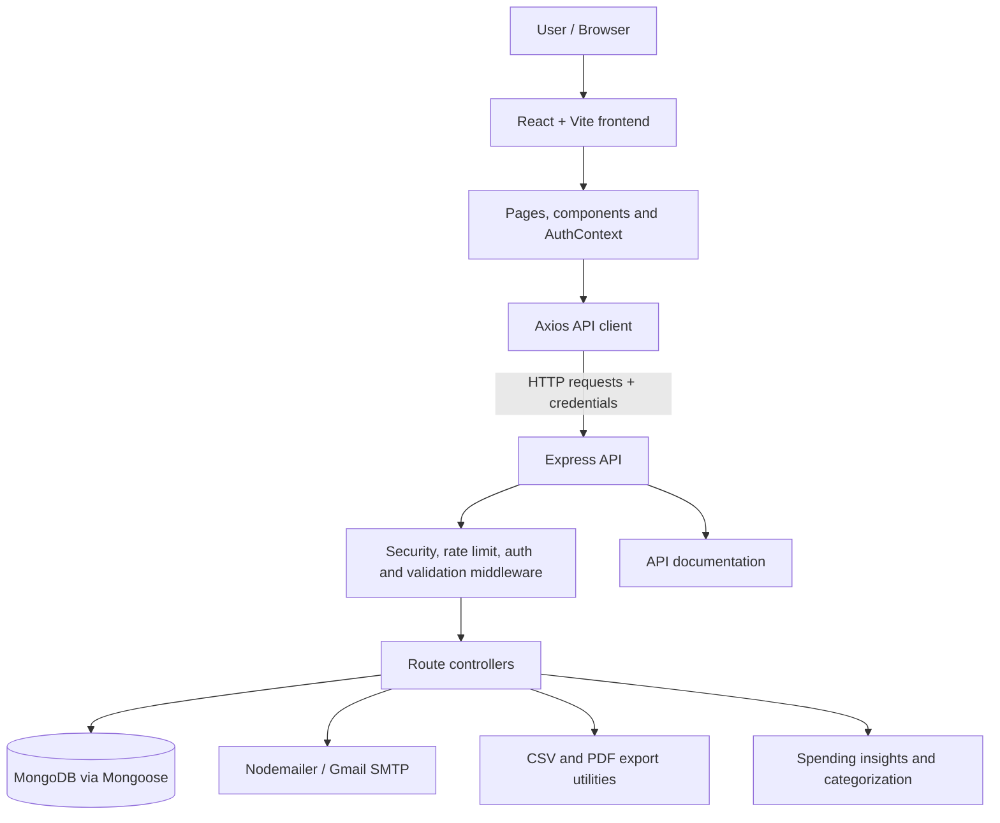

# SmartSpend

SmartSpend is a full-stack personal finance and expense management application. It provides a dashboard for tracking expenses and income, managing monthly and category budgets, organizing financial accounts, reviewing spending trends, and exporting reports.

The repository contains a **React 19 + Vite frontend** and an **Express 5 + MongoDB backend**. Authentication supports email/password flows and Google sign-in. The application also includes rule-based expense categorization and data-driven spending insights.

## Contents

- [Features](#features)
- [Technology Stack](#technology-stack)
- [Application Architecture](#application-architecture)
- [Repository Structure](#repository-structure)
- [Getting Started](#getting-started)
- [Environment Variables](#environment-variables)
- [Running the Application](#running-the-application)
- [API Overview](#api-overview)
- [Data Models](#data-models)
- [Authentication and Security](#authentication-and-security)
- [Testing and Quality Checks](#testing-and-quality-checks)
- [Deployment Notes](#deployment-notes)
- [Troubleshooting](#troubleshooting)

## Features

### Personal finance management
- Record, view, edit, delete, search, filter, sort, and paginate expense entries.
- Track income entries by category and date.
- Record recurring expenses with daily, weekly, or monthly frequencies, and activate or pause them.
- Manage multiple financial accounts, including cash, bank, UPI, and credit-card accounts.
- Transfer funds between accounts.

### Budgets and insights
- Set a monthly spending limit and individual category limits.
- Compare actual spending with budget targets and surface budget warnings.
- View dashboard summaries, category breakdowns, and monthly spending trends.
- Review analytics, growth analytics, monthly reports, and spending suggestions.
- Automatically suggest expense categories using keyword-based matching.

> **About the insights:** Expense categorization is implemented with keyword rules in `backend/utils/categorize.js`. Spending insights are calculated from the user's expense, income, and budget records in the backend. The repository does not show an external generative-AI service powering these calculations.

### Reports and account access
- Export expense data as CSV or PDF.
- Register with a Gmail address and verify it using an emailed code.
- Sign in with email/password or Google OAuth.
- Recover a password using a verification code.
- Update profile preferences, currency, and password.
- Use protected application routes for authenticated pages.

## Technology Stack

| Layer | Technologies |
|---|---|
| Frontend | React 19, Vite 8, React Router 7 |
| UI and visualization | Tailwind CSS 3, Framer Motion, Lucide React, Recharts, Three.js / React Three Fiber |
| Frontend API and authentication | Axios, `@react-oauth/google` |
| Backend | Node.js, Express 5 |
| Database | MongoDB, Mongoose 9 |
| Authentication | JSON Web Tokens, bcryptjs, HTTP-only cookies, Google Auth Library |
| Validation and security | express-validator, Helmet, CORS, express-rate-limit, xss-clean |
| Email and exports | Nodemailer, json2csv, PDFKit |
| Logging and monitoring | Winston, Morgan, Sentry |
| Tests | Node.js test runner, Vitest, Testing Library, jsdom |

## Application Architecture



### Request flow

1. The user interacts with a React page.
2. Frontend API modules send requests through the shared Axios client. The client uses `VITE_API_URL` and enables credentials.
3. Express applies security headers, CORS, JSON parsing, cookie parsing, request logging (in development), and API rate limiting.
4. Route middleware validates input and protects authenticated endpoints.
5. Controllers perform application logic and use Mongoose models to read or update MongoDB.
6. The API returns JSON responses or a downloadable CSV/PDF file.

## Repository Structure

```text
smartspend-main/
├── backend/
│   ├── config/
│   │   └── db.js                  # MongoDB connection
│   ├── controllers/               # Request handlers and business logic
│   │   ├── accountController.js
│   │   ├── authController.js
│   │   ├── budgetController.js
│   │   ├── expenseController.js
│   │   ├── exportController.js
│   │   ├── incomeController.js
│   │   └── insightController.js
│   ├── docs/
│   │   └── apiDocs.js              # API documentation metadata
│   ├── middleware/
│   │   ├── auth.js                 # Authentication guard
│   │   ├── errorHandler.js
│   │   ├── notFound.js
│   │   ├── rateLimiter.js
│   │   └── validate.js
│   ├── models/                     # Mongoose schemas
│   │   ├── Account.js
│   │   ├── Budget.js
│   │   ├── Expense.js
│   │   ├── Income.js
│   │   ├── OTP.js
│   │   └── User.js
│   ├── routes/                     # REST API route definitions
│   │   ├── accounts.js
│   │   ├── auth.js
│   │   ├── budget.js
│   │   ├── docs.js
│   │   ├── expenses.js
│   │   ├── export.js
│   │   ├── income.js
│   │   └── insights.js
│   ├── scripts/
│   │   └── seedDemoUser.js
│   ├── test/                       # Node test-runner tests
│   ├── utils/                      # Categorization, email, exports, logging, Sentry
│   ├── .env.example
│   ├── package.json
│   └── server.js
├── frontend/
│   ├── public/                     # Static icons and favicon
│   ├── src/
│   │   ├── api/                    # Axios instance and API modules
│   │   ├── assets/
│   │   ├── components/
│   │   │   ├── auth/
│   │   │   ├── cards/
│   │   │   ├── charts/
│   │   │   ├── layout/
│   │   │   └── ui/
│   │   ├── context/
│   │   │   └── AuthContext.jsx
│   │   ├── pages/                  # Landing, auth, dashboard and finance screens
│   │   ├── test/
│   │   ├── utils/
│   │   ├── App.jsx                 # Route configuration
│   │   ├── index.css
│   │   └── main.jsx
│   ├── .env.example
│   ├── package.json
│   └── vite.config.js
├── package.json                   # Small root dependency manifest
└── README.md
```

### Frontend pages

| Page | Purpose |
|---|---|
| `Landing` | Public landing page |
| `Login`, `Register` | User authentication |
| `Dashboard` | Financial overview |
| `Expenses`, `RecurringExpenses` | Expense and recurring expense management |
| `Income` | Income tracking |
| `Budget` | Monthly and category budgets |
| `Analytics`, `GrowthAnalytics` | Charts and financial trends |
| `Insights` | Spending insights and saving suggestions |
| `MonthlyReport` | Monthly financial report |
| `ExportCenter` | CSV/PDF export interface |
| `Settings` | Profile and account settings |
| `AboutProject` | Project information |

The authenticated pages are wrapped in `ProtectedRoute` and `DashboardLayout`. Public authentication pages use `PublicRoute`. Page components are lazy-loaded through React Router.

## Getting Started

### Prerequisites

Install the following before running the project:

- Node.js (use a current LTS release) and npm.
- A MongoDB database, either local MongoDB or MongoDB Atlas.
- A Gmail SMTP app password if you want email verification and password-reset emails.
- A Google OAuth client ID if you want Google sign-in.

### 1. Clone the repository

```bash
git clone <your-repository-url>
cd smartspend-main
```

Replace `<your-repository-url>` with the URL of your GitHub repository.

### 2. Configure the backend

```bash
cd backend
npm install
```

Create a `.env` file by copying the example:

```bash
cp .env.example .env
```

On Windows Command Prompt, use:

```bat
copy .env.example .env
```

Set at least `MONGO_URI` and `JWT_SECRET` in `backend/.env`. Configure SMTP and Google OAuth values for the corresponding authentication features.

### 3. Configure the frontend

Open a second terminal:

```bash
cd frontend
npm install
```

Create the frontend environment file:

```bash
cp .env.example .env
```

On Windows Command Prompt:

```bat
copy .env.example .env
```

For local development, the default `VITE_API_URL` points to `http://localhost:5000/api`. Set the Google client ID if Google sign-in is enabled.

## Environment Variables

### Backend (`backend/.env`)

| Variable | Description |
|---|---|
| `PORT` | Express server port. Defaults to `5000`. |
| `MONGO_URI` | MongoDB connection string. |
| `JWT_SECRET` | Secret used to sign JWTs. Use a long, random, private value. |
| `JWT_EXPIRE` | JWT lifetime, e.g. `30d`. |
| `COOKIE_SAMESITE` | SameSite cookie policy; example uses `lax`. |
| `NODE_ENV` | Runtime environment, e.g. `development` or `production`. |
| `GOOGLE_CLIENT_ID` | Google OAuth client ID used by the backend. |
| `SMTP_HOST` | SMTP host for email delivery. |
| `SMTP_PORT` | SMTP port; example uses `465`. |
| `SMTP_USER` | SMTP account username. |
| `SMTP_PASS` | SMTP password or Gmail app password. |
| `EMAIL_FROM` | Sender identity used for application emails. |
| `DEMO_NAME` | Optional demo user's display name for the seed script. |
| `DEMO_EMAIL` | Optional demo user's email for the seed script. |
| `DEMO_PASSWORD` | Optional demo user's password for the seed script. |
| `SENTRY_DSN` | Optional backend Sentry project DSN. |
| `SENTRY_TRACES_SAMPLE_RATE` | Sentry tracing sample rate. |

### Frontend (`frontend/.env`)

| Variable | Description |
|---|---|
| `VITE_API_URL` | Backend API base URL. Defaults to `http://localhost:5000/api`. |
| `VITE_DEMO_EMAIL` | Demo email displayed/used by the frontend demo flow. |
| `VITE_DEMO_PASSWORD` | Demo password displayed/used by the frontend demo flow. |
| `VITE_GOOGLE_CLIENT_ID` | Google OAuth client ID used by the Google sign-in UI. |
| `VITE_SENTRY_DSN` | Optional frontend Sentry DSN. |
| `VITE_SENTRY_TRACES_SAMPLE_RATE` | Frontend tracing sample rate. |
| `VITE_SENTRY_REPLAYS_SESSION_SAMPLE_RATE` | Session replay sample rate. |
| `VITE_SENTRY_REPLAYS_ON_ERROR_SAMPLE_RATE` | Error-session replay sample rate. |

**Important:** Never commit real `.env` files, database credentials, OAuth secrets, SMTP credentials, or production demo passwords. Frontend variables prefixed with `VITE_` are bundled into client-side code and must not contain secrets.

## Running the Application

Start the backend from the `backend` directory:

```bash
npm run dev
```

Start the frontend from the `frontend` directory in another terminal:

```bash
npm run dev
```

Vite normally serves the frontend at `http://localhost:5173`; the API runs at `http://localhost:5000` unless configured otherwise.

Check the backend health endpoint:

```text
http://localhost:5000/api/health
```

The API documentation is available at:

```text
http://localhost:5000/api/docs
```

A machine-readable documentation response is available at:

```text
http://localhost:5000/api/docs.json
```

### Optional demo user

The backend provides a seed script:

```bash
cd backend
npm run seed:demo
```

It creates or updates the demo user using `DEMO_NAME`, `DEMO_EMAIL`, and `DEMO_PASSWORD` from the backend environment (with development defaults if unset). Use this only with a development database. Do not expose the default demo credentials in a public production deployment.

## API Overview

All API routes use the `/api` prefix. Most finance endpoints require authentication.

| Group | Base path | Purpose |
|---|---|---|
| Health | `GET /api/health` | API status and version |
| Authentication | `/api/auth` | Registration, verification, login, Google auth, password recovery, profile and account actions |
| Expenses | `/api/expenses` | Expense CRUD, filtering, summary statistics and recurring expenses |
| Income | `/api/income` | Income CRUD and filtered income listing |
| Budgets | `/api/budget` | Read and create/update budget data |
| Insights | `/api/insights` | Spending insights and saving suggestions |
| Accounts | `/api/accounts` | Account CRUD and fund transfers |
| Exports | `/api/export` | CSV and PDF downloads |
| API docs | `/api/docs`, `/api/docs.json` | Human-readable and JSON API documentation |

### Selected endpoints

| Method | Endpoint | Authentication | Description |
|---|---|---:|---|
| `GET` | `/api/health` | No | Health check |
| `POST` | `/api/auth/register` | No | Begin local registration |
| `POST` | `/api/auth/verify-email` | No | Verify email code |
| `POST` | `/api/auth/login` | No | Log in |
| `POST` | `/api/auth/google` | No | Google sign-in |
| `POST` | `/api/auth/forgot-password` | No | Request password reset |
| `POST` | `/api/auth/reset-password` | No | Reset password with code |
| `POST` | `/api/auth/logout` | No | Log out |
| `GET` | `/api/auth/me` | Yes | Current user profile |
| `PUT` | `/api/auth/update-profile` | Yes | Update profile preferences |
| `GET`, `POST` | `/api/expenses` | Yes | List and create expenses |
| `GET`, `PUT`, `DELETE` | `/api/expenses/:id` | Yes | Read, update, or delete an expense |
| `GET` | `/api/expenses/stats/summary` | Yes | Expense summary |
| `GET`, `POST` | `/api/expenses/recurring` | Yes | List and create recurring expenses |
| `GET`, `POST` | `/api/income` | Yes | List and create income records |
| `DELETE` | `/api/income/:id` | Yes | Delete an income record |
| `GET`, `POST` | `/api/budget` | Yes | Read or save budget |
| `GET` | `/api/insights` | Yes | Retrieve spending insights |
| `GET`, `POST` | `/api/accounts` | Yes | List and create accounts |
| `PUT`, `DELETE` | `/api/accounts/:id` | Yes | Update or delete an account |
| `POST` | `/api/accounts/transfer` | Yes | Transfer funds between accounts |
| `GET` | `/api/export/csv` | Yes | Export expense data as CSV |
| `GET` | `/api/export/pdf` | Yes | Export expense data as PDF |

The full endpoint definitions and example request metadata are maintained in `backend/docs/apiDocs.js`; consult `/api/docs` for the current API reference. Request validation is implemented on the backend, so clients should send values that satisfy the route validators and Mongoose schemas.

### Authentication behavior

- Browser requests use credentialed Axios requests (`withCredentials: true`).
- The backend documents an HTTP-only cookie named `smartspend_token` for browser sessions.
- The authentication middleware also accepts a bearer token for API tools and compatible clients.
- Protected endpoints require a valid authenticated user.

## Data Models

The backend uses Mongoose models. Finance records are associated with a user, supporting per-user data access.

| Model | Main purpose | Important fields |
|---|---|---|
| `User` | Identity and preferences | Name, email, password hash, auth provider, email verification state, currency, monthly budget |
| `OTP` | Time-limited verification codes | Email, OTP, expiry, attempt count |
| `Expense` | Expense transactions | User, title, amount, category, payment method, date, notes, recurring fields |
| `Income` | Income transactions | User, title, amount, category, date, notes, recurring flag |
| `Budget` | Monthly and category limits | User, monthly limit, category budgets, month, year |
| `Account` | Financial accounts | User, name, account type, balance, color, icon, default/active flags |

The `Expense` model defines indexes for user/date and user/category queries. `Income` defines a user/date index. `OTP` uses a MongoDB TTL index on `expiresAt` so expired verification records can be removed automatically.

## Authentication and Security

The backend includes:
- Password hashing with bcryptjs.
- JWT-based authentication.
- HTTP-only cookie support and bearer-token compatibility.
- Google ID-token verification.
- Email verification and password-reset flows.
- Request validation with express-validator.
- Helmet security headers, CORS configuration, and API rate limiting.
- Centralized 404 and error handling.
- Optional Sentry monitoring and Winston logging.

### Production configuration checklist

Before deployment:
1. Set a strong, unique `JWT_SECRET` and production database credentials.
2. Set `NODE_ENV=production`.
3. Configure trusted frontend origins in the backend CORS configuration. The current source explicitly allows localhost origins; update this for your deployed frontend.
4. Review cookie `Secure`, `SameSite`, domain, and HTTPS settings for the deployment topology.
5. Configure valid Google OAuth origins and redirect/authorized JavaScript origins as required by your Google client.
6. Configure SMTP with an app password or a dedicated email provider.
7. Remove or rotate demo credentials and never seed a public production database with the development defaults.
8. Configure Sentry DSNs and appropriate sampling rates if monitoring is required.

## Testing and Quality Checks

### Backend tests

```bash
cd backend
npm test
```

The backend uses Node's built-in test runner (`node --test`). Current tests are located in `backend/test/`.

### Frontend tests

```bash
cd frontend
npm test
```

Frontend tests use Vitest and Testing Library. Test setup is configured in `frontend/vite.config.js` and `frontend/src/test/setup.js`.

### Frontend lint and production build

```bash
cd frontend
npm run lint
npm run build
```

Use these commands before submitting changes or deploying the frontend.

## Deployment Notes

Deploy the frontend and backend as separate services or through an architecture that supports both. Provision MongoDB independently and configure environment variables in the hosting provider's secret/environment settings.

- Build the frontend with `npm run build` from `frontend/` and serve the generated `frontend/dist/` directory through a static host or CDN.
- Run the backend with `npm start` from `backend/`.
- Set `VITE_API_URL` to the publicly reachable API base URL before building the frontend.
- Update backend CORS origins and cookie settings to match the deployed frontend domain and HTTPS configuration.
- Ensure the backend hosting platform supports outbound SMTP connections if email verification is enabled.

## Troubleshooting

| Problem | Things to check |
|---|---|
| Backend exits during startup | Confirm `MONGO_URI` is valid and the database is reachable. |
| Frontend cannot reach the API | Check `VITE_API_URL`, backend port, CORS origins, and browser network errors. |
| Login works but protected pages redirect | Confirm cookies are enabled, `withCredentials` is active, and cookie domain/SameSite/Secure settings match the deployment. |
| Verification email is not delivered | Check SMTP host, port, Gmail app password, sender address, and provider restrictions. |
| Google sign-in fails | Ensure frontend and backend client IDs match and the domain is authorized in Google Cloud. |
| Export fails | Check the authenticated session and inspect backend logs for CSV/PDF generation errors. |

## Contributing

1. Fork the repository and create a feature branch.
2. Keep frontend components, API modules, backend routes, controllers, and models organized by responsibility.
3. Add or update tests for behavior changes.
4. Run backend tests, frontend tests, linting, and the frontend production build.
5. Open a pull request describing the change and any environment/configuration impact.

## License

No license file was present in the inspected repository. Add a `LICENSE` file and update this section before redistributing the project or accepting external contributions.
